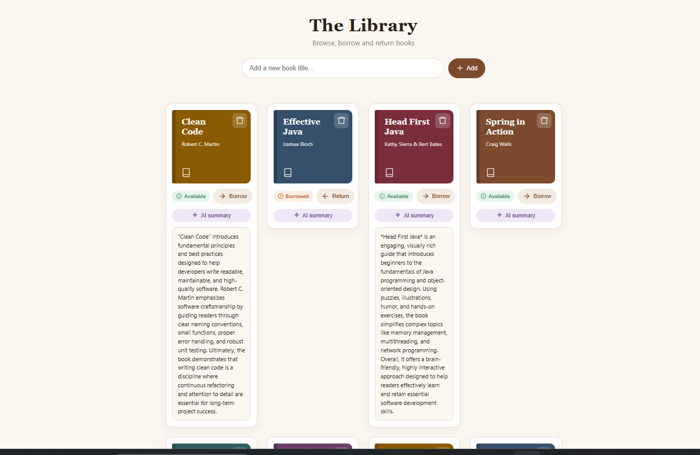

# Library API

A library management REST API built with **Java 21** and **Spring Boot**, with a simple web page to browse, borrow, return and delete books.



## Features
- List, add and delete books
- Borrow and return a book (availability is tracked)
- Data is stored in a file-based H2 database, so it survives restarts
- Sample books are added automatically on first run
- Simple HTML page served by Spring Boot

## Tech stack
- Java 21, Spring Boot, Maven
- Spring Web (REST), Spring Data JPA / Hibernate
- H2 database
- HTML, CSS and JavaScript (single page)

## Architecture
`Controller` (HTTP requests) -> `Library` service (business logic) -> `BookRepository` (database)

## API endpoints
| Method | Endpoint | Description |
|---|---|---|
| GET | `/books` | List all books |
| POST | `/books` | Add a book (JSON body) |
| PUT | `/books/{title}/borrow` | Borrow a book |
| PUT | `/books/{title}/return` | Return a book |
| DELETE | `/books/{id}` | Delete a book |

Example request body for `POST /books`:
```json
{ "title": "Clean Code", "author": "Robert C. Martin" }
```
## Backend in action

`GET /books` returns the books as JSON:


Data is stored in an H2 database through Spring Data JPA:


REST endpoints in `BookController`:


## Run locally
Requirements: Java 21.

```bash
./mvnw spring-boot:run
```
Then open http://localhost:8080

## Roadmap
- [ ] AI-generated book summaries
- [ ] Deployment to AWS
