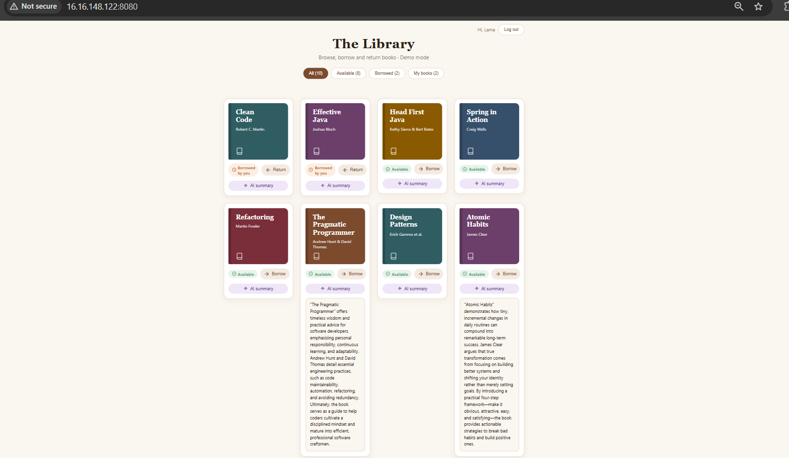
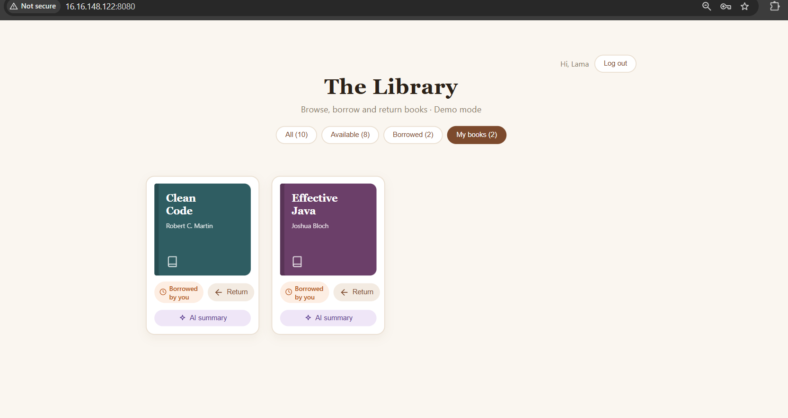
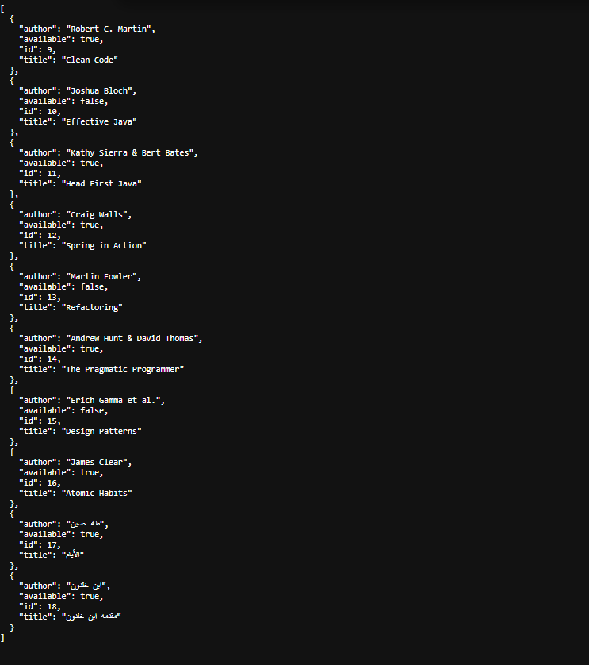
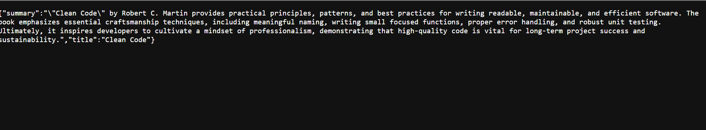
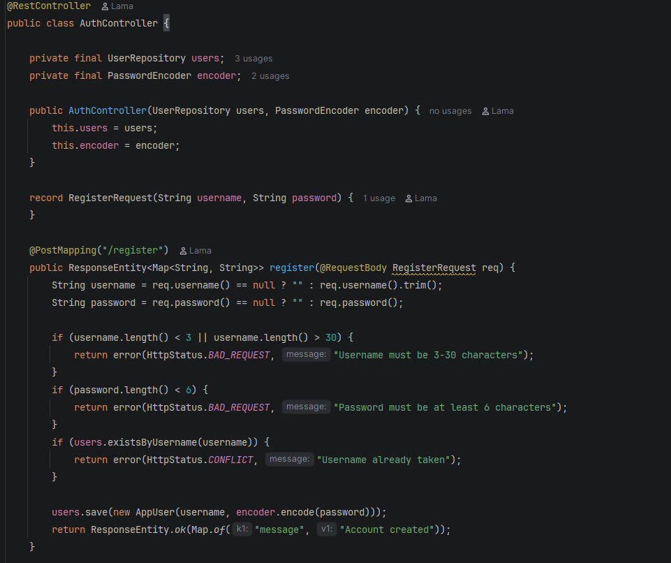
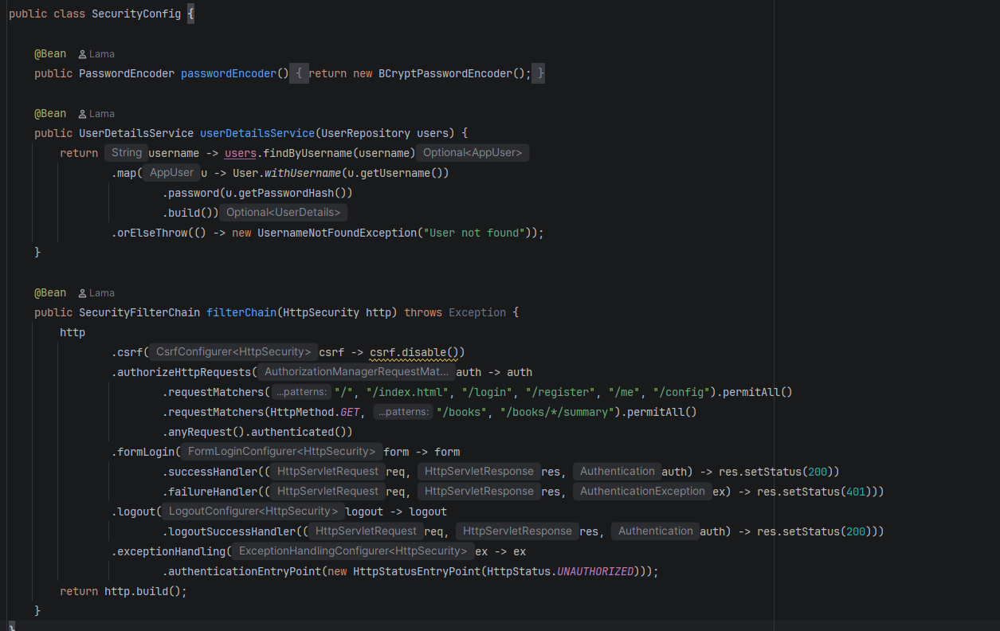
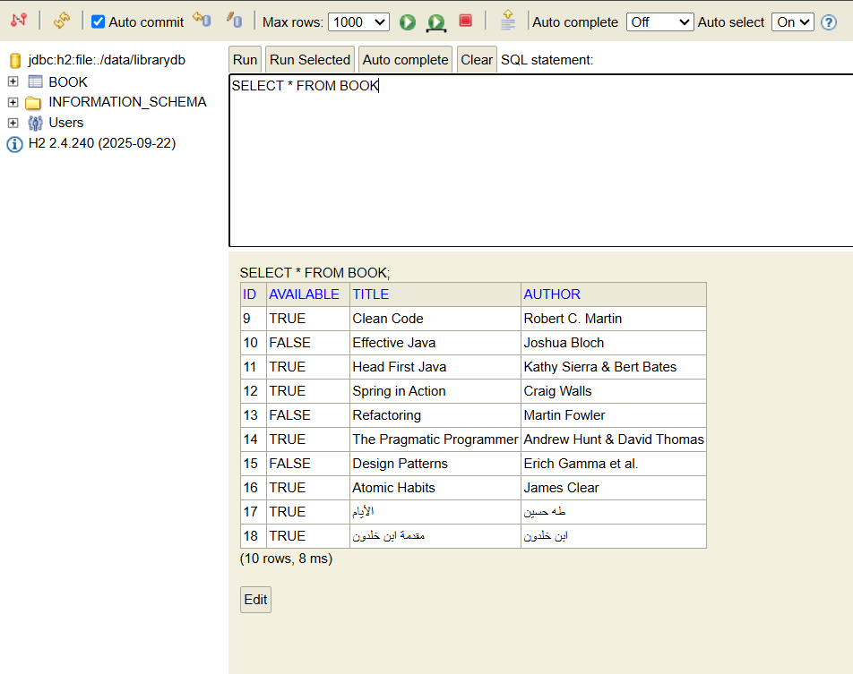
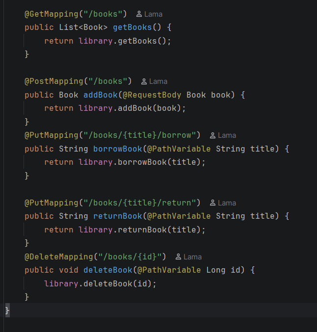

# Library API

A library management REST API built with **Java 21** and **Spring Boot**, with a web page to browse, borrow and return books, **user accounts with login**, and AI-generated book summaries.

**Live demo:** http://16.16.148.122:8080 (deployed on AWS EC2, demo mode, plain HTTP for now, so please don't use a real password)



## Features
- User accounts: sign up, log in and log out (Spring Security, passwords hashed with BCrypt)
- Per-user borrowing: borrow a book, see it under **My books**, and only the borrower can return it
- Filter tabs: All, Available, Borrowed and My books
- AI-generated book summaries powered by Gemini (cached in memory to limit API calls)
- Data is stored in a file-based H2 database, so it survives restarts
- Sample books are added automatically on first run
- Simple HTML page served by Spring Boot
- Demo mode: set `DEMO_MODE=true` to block adding and deleting books (used on the live site)

## Tech stack
- Java 21, Spring Boot, Maven
- Spring Web (REST), Spring Data JPA / Hibernate
- Spring Security (session-based login, BCrypt)
- H2 database
- Gemini API (called from the backend with `RestClient`)
- HTML, CSS and JavaScript (single page)
- AWS EC2 (Amazon Linux 2023) for hosting

## Architecture
`Controller` (HTTP requests) -> `Library` service (business logic) -> `BookRepository` (database)

`AuthController` handles registration, `SecurityConfig` protects the endpoints, and `UserRepository` stores users (with hashed passwords).

`GeminiService` calls the Gemini API to summarize a book. The API key is read only from an environment variable, never stored in the code.

## API endpoints
| Method | Endpoint | Auth | Description |
|---|---|---|---|
| GET | `/books` | Public | List all books |
| GET | `/books/{id}/summary` | Public | AI-generated summary of a book |
| GET | `/books/mine` | Login | Books borrowed by the current user |
| PUT | `/books/{title}/borrow` | Login | Borrow a book |
| PUT | `/books/{title}/return` | Login | Return a book (only by the borrower) |
| POST | `/books` | Login | Add a book (JSON body) |
| DELETE | `/books/{id}` | Login | Delete a book |
| POST | `/register` | Public | Create an account (JSON body) |
| POST | `/login` | Public | Log in (form: `username`, `password`) |
| POST | `/logout` | Login | Log out |
| GET | `/me` | Public | Current user, or `loggedIn: false` |
| GET | `/config` | Public | Returns whether demo mode is on |

Example request body for `POST /register`:
```json
{ "username": "lama_demo", "password": "secret123" }
```

## Backend in action

My books: each user sees only the books they borrowed, with a Return button:



`GET /books` returns the books as JSON:



`GET /books/{id}/summary` returns an AI-generated summary:



## Security
- Passwords are never stored in plain text, they are hashed with BCrypt
- Login uses a session cookie, and JSON-friendly responses (200 on success, 401 on failure)
- Reading books is public, everything else requires login
- A user can only return books they borrowed themselves

Registration with input validation and password hashing:



Security configuration:



## More of the code

Data is stored in an H2 database through Spring Data JPA:



REST endpoints in `BookController`:



## Run locally
Requirements: Java 21.

```bash
./mvnw spring-boot:run
```
Then open http://localhost:8080

To enable AI summaries, set a `GEMINI_API_KEY` environment variable with your own Gemini API key. The rest of the app works without it.

## Deployment
The app runs on an AWS EC2 instance (Amazon Linux 2023, Java 21 Corretto):
- Built on the server with the Maven wrapper and started as a background process
- A fixed Elastic IP keeps the URL stable
- Security group: port 8080 open to the public, SSH restricted to AWS EC2 Instance Connect
- `GEMINI_API_KEY` and `DEMO_MODE` are set as environment variables on the server

The live demo runs on a limited AWS free plan, so the link may be taken down later. The screenshots above show the app running.

## What I'd improve
- Add HTTPS with a domain name and a reverse proxy (login currently runs over plain HTTP, which is why the demo asks users not to use a real password)
- Email verification and password reset
- Enable CSRF protection (currently disabled to keep the JSON API simple)
- Better error handling (for example, a proper `/error` response instead of 401 for server errors) and unit tests
- Replace H2 with PostgreSQL (for example on AWS RDS)
- Run the app as a system service so it restarts automatically after a reboot

## Roadmap
- [x] AI-generated book summaries
- [x] Deployment to AWS
- [x] User accounts, login and per-user borrows
- [ ] HTTPS and a domain name
- [ ] PostgreSQL
- [ ] Unit tests
